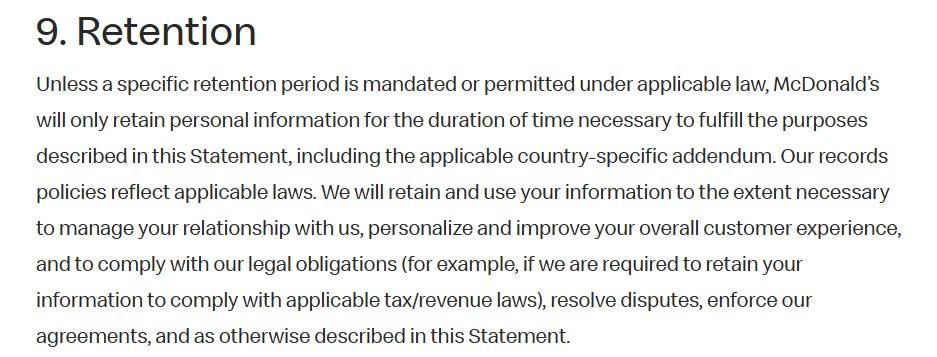
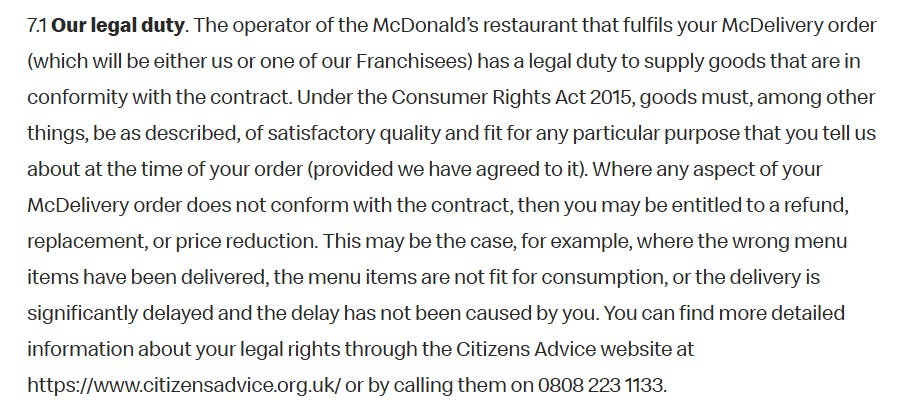
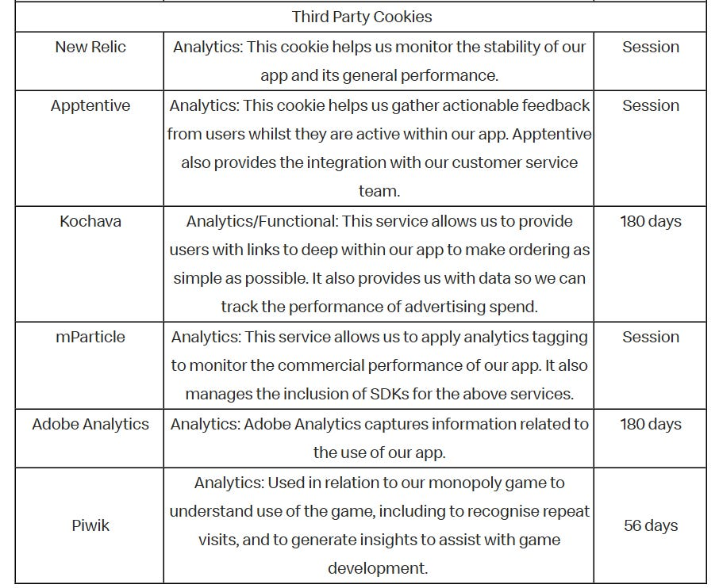
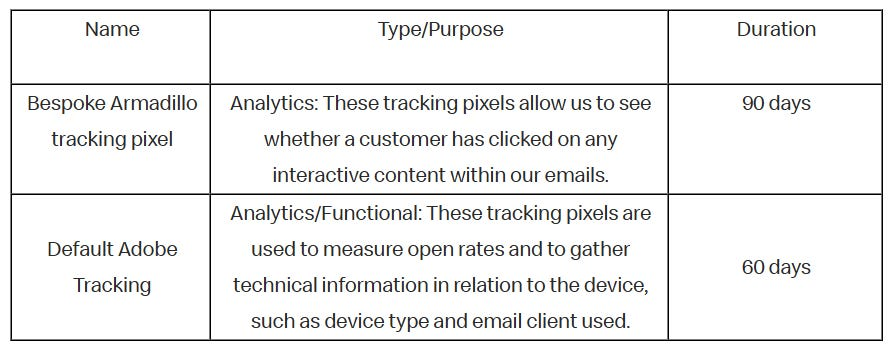

This article consists of a review of McDonalds;

* [Privacy Statement](https://www.mcdonalds.com/gb/en-gb/privacy-policy.html)  
* [Global Privacy Policy](https://www.mcdonalds.com/gb/en-gb/privacy-policy/full.html)  
* [Terms & Conditions](https://www.mcdonalds.com/gb/en-gb/terms-and-conditions.html)  
* [Cookie Policy](https://www.mcdonalds.com/gb/en-gb/cookie-policy.html)  
* [Online Services Terms & Conditions](https://www.mcdonalds.com/gb/en-gb/terms-and-conditions.html)  
* [Rewards Terms](https://www.mcdonalds.com/gb/en-gb/terms-and-conditions/my-mcdonalds-rewards-terms.html)

Many McDonalds restaurants are owned and operated by franchisees who are independent business owners, thus McDonald's make clear that much information is subject to the individual policies of franchise owners, but that they may remain to collect personal information when a person visits a restaurant, uses their website or apps, or otherwise interacts with them as a company.

# WHAT INFORMATION IS COLLECTED BY MCDONALDS

McDonald’s collect the following information, which is freely given by users in order to engage with some of their services (particularly their app);

* Name  
* Postal address  
* Email address  
* Phone number  
* Birthday information  
* Age  
* Gender  
* Transaction information (including about the products you buy, prices, method of payment)  
* Username  
* Password  
* Preferred times of visit/purchase  
* Payment information (card details)  
* Location Data (if using the order ahead feature of the app

They describe the information they collect through automated technology as;

* IP address  
* Computer or mobile device operating system  
* Browser type  
* Type of mobile device and its settings  
* Unique device identifier (UDID) or mobile equipment identifier (MEID) of device  
* Device and component serial numbers  
* Advertising identifiers  
* Referring webpage or application  
* Online activity on other websites, applications or social media  
* Visits to restaurants  
* GPS  
* Wi-Fi  
* BluetoothCell tower proximity

McDonalds state that they may combine information collected from users with information that they collect through automated methods and from other sources.

They describe the other sources as;

* McDonald’s Corporation  
* McDonalds Global Markets LLC  
* Affiliates  
* Subsidiaries  
* Franchisees  
* Business partners  
* Vendors (food delivery platforms, data providers, payment processors)  
* Public sources

Unlike many corporations which state they do not actively collect the data of children, McDonalds state *“We do not intend to process personal information about any child unless data is needed for a specific activity of which their parent or legal guardian is fully aware…”*.

They state that Body Worn Cameras (BWCs) may be used in some McDonald’s restaurants, noting that they may capture audio and video but are switched off by default, only capturing recordings is activated by a crew member.

Images of customers head and shoulders are also captured on using a drive through facility captured at the time of the customer placing the order. They state that the image is not permanently saved to any device, that it is only displayed on the cashiers till and deleted within 30 minutes of the sale being completed.

# DATA RETENTION

The statement on data retention is brief, and doesn’t really provide any real clarity

# WHAT IS DISCLOSED AND WITH WHO

Personal information may be shared with;

* Other McDonald’s companies within The McDonalds Family  
* Suppliers  
* Franchisees  
* IT service providers  
* Marketing agencies  
* Public authorities and Courts  
* Business partners (e.g. food delivery platforms i.e. if ordering through the McDonalds App, personal information is shared with Uber Eats to facilitate the delivery)  
* Advertising partners (including customer match advertising services)  
* Meta  
* Snap  
* Twitter  
* Google  
* AI

Due to the global nature of the corporation and international locations of franchisees, data may be shared throughout the global network including being located on servers outside of the jurisdiction of the user.

Polite reminder, that data shared becomes subject to the privacy policies and terms of the receiver of the data (and in turn, their third parties etc etc).

With regard to sharing with AI, they do not disclose much beyond *“we use AI to assist us in providing you with effective customer service. For more information about how we use AI, please contact us…”*

# TERMS OF SERVICE

When a user signs up for McDonalds Rewards, they consent through those terms for their information to be used for their experience to be personalised.

Orders cannot be cancelled once paid. The legal right to change your mind and cancel a contract during the “cooling off” period according to the McDonalds Terms, does not apply.

However, Consumer Rights still apply;

If a user engages with the App to place an order, whether for collection or delivery, the user is entering into a legal contract, thus users of the App must be aged 18+.

If a person makes an order through the app where the delivery is fulfilled by Uber Eats, that person is entering into around four different legal contracts in order to receive that service.

100% of tips go to the delivery driver (where that service is used)

# COOKIES

McDonalds deploy a number of their own cookies, in addition to some of the third party kind;

