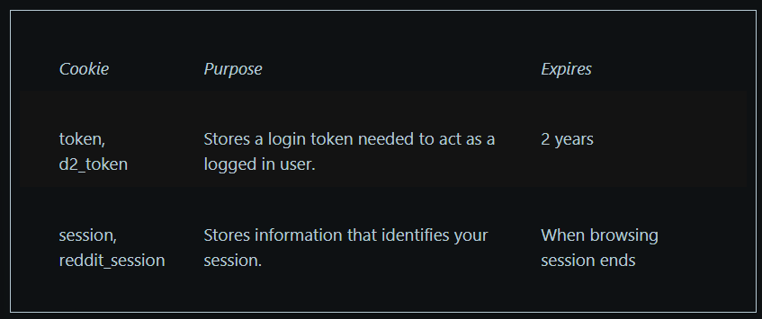

Claiming around 500 million active weekly users enabling them a revenue of \$2.2 billion in 2025, a remarkable estimated \$2.06 billion of which stemmed from advertising to their users, they describe themselves as “the place for people to gather for conversations about the things they care about”, which is a funny way of saying they’re basically an advertising company.

This article consists of a review of Reddit’s;

* Privacy Policy  
* User Agreement  
* Developer Terms  
* Public Content Policy  
* Cookie Notice  
* Reddit Econ Terms  
* Creator Terms  
* Previews Terms of Use  
* Developer Data Protection Addendum  
* Reddit Rules  
* Transparency Reports

# WHAT INFORMATION IS COLLECTED BY REDDIT

Reddit emphasise that a user does not need an account to use Reddit, but that choosing to use Reddit without an account will limit the experience.

Reddit seek to emphasise that due to the nature of not needing an account to view the service, that any data collected through a created account is voluntarily provided.

If a user chooses to create an account, Reddit will collect;

* Username  
* Password (if not using Single Sign-On (SSO)) feature  
* Mobile number (particularly if using SSO)  
* Interests  
* User account preferences

The following information Reddit collects, but they lean on the “this is all provided voluntarily” angle.

* Bio  
* Gender  
* Birthday  
* Location  
* Language (being used and settings on device)  
* Profile picture  
* Social Links  
* Public content (including posts, comments, chat messages, usernames and some of the users profile information as well as related metadata. May also include; text, links, images, gifs, audio, videos etc).  
* Saved drafts of posts or comments  
* Non-public messages with other users (including private messages, private chats and modmail)  
* Reports  
* Forms/Feedback provided  
* Actions the user takes (including voting, saving, hiding and reporting, interactions with user users.  
* If purchasing products from or through Reddit; payment information, the product and/or service being purchased, purchase date(s), amount(s) paid or received.  
* Public blockchain data and addresses; such as when a user purchases or creates a Collectible Avatar, receive or mint an NFT or create a Reddit Vault (Reddit Vault private key information is “never stored”

Reddit state they automatically collect some information as the user interacts with and uses their services, which may include;

* IP address  
* User agent string  
* Browser type  
* Operating system  
* Referring URLs  
* Device ID  
* Device settings  
* Mobile carrier name  
* Pages visited  
* How the user interacts with content, ads and communities  
* Upvotes/downvotes  
* Links clicked  
* The requesting URL  
* Search terms used  
* Information collected through Cookies  
* Approximate location

Reddit state they may also collect information of/about users from other sources such as;

* Linked Services (third-party services)  
* Advertising partners  
* From Integrations (including embeds, advertising technology or app store APIs)  
* Unofficial mobile app client (where used by the user)

There are some additional sections of policy which apply if a user engages with certain offerings from Reddit, under which Reddit collects the following data;

## Reddit Ad Users

* Name  
* Email address  
* Information about the users company  
* Documentation to verify identity (where requested/provided)  
* *“When using Reddit Ads, we may record a session replay of your visit for customer service, trouble shooting, and usability research purposes”*.

## Reddit Pro Users

* Profile type  
* Name  
* Industry category  
* Website  
* Organisation size  
* Documentation to verify identity (where requested/provided)

## Reddit Program Participants (Contributor Program etc) (& Potential Participants)

* Name  
* Date of birth  
* Address  
* Email  
* Tax ID  
* Government ID  
* Payment Information

# DATA RETENTION

Except for the IP address used to create an account, which is retained indefinitely, any other collected IP addresses are deleted after 100 days.

Reddit is a public platform, and is subject to much scraping, they note that they “cannot guarantee that third parties have deleted copies of Reddit public content they’ve made without your of our permission” \- including a small paragraph about the rise of AI misusing public data in said scraping fashion has become more prominent.

Information Reddit collects, they store for “as long as necessary for the purpose(s) for which we originally collected it” which they cite as being “legitimate business purposes”.

# WHAT IS DISCLOSED AND WITH WHO

Reddit does not control how third party services collect personal data when they serve their content via embeds, data collected through embeds are subject to the controller of the embeds policies.

As a global platform with international operations, servers are based in the US, but data is transferred to affiliates, service providers and third parties located in various other countries.

They also state that they may share data;

* With the users consent (its in the terms that the user consents)  
* With linked services  
* With service providers  
* To comply with the law  
* With affiliates

## Reddit Program Participants (Contributor Program etc) (& Potential Participants)

Data is shared with Reddit’s third-party payment and compliance providers to determine eligibility in the program and facilitate payments and is subject to the third-party providers privacy policies and terms.

# TERMS OF SERVICE

Persons under 13 are not permitted to use Reddit services, and users must be at least 18 years old to view mature content.

User is responsible for their Content, which could expose them to liability if the user posts or shares Content without all of the necessary rights to post or share said content.

User retains ownership rights in their content, but grant to Reddit a “worldwide, royalty-free, perpetual, irrevocable, non-exclusive, transferable, and sublicensable license to use, copy, modify, adapt, prepare derivative works of, distribute, store, perform, and display Your Content and any name, username, voice, or likeness provided in connection with Your Content in all media formats and channels now known or later developed anywhere in the world. This license includes the right for us to make Your Content available for syndication, broadcast, distribution, or publication by other companies, organizations, or individuals who partner with Reddit”.

Reddit claim to have “no obligation to screen, edit or monitor your Content, we may, in our sole discretion, delete, deem your Content ineligible for monetization or remove your Content, at any time and for any reason…”

Moderators are required to follow a code of conduct. Reddit reserves the right (but has no obligation to) overturn any action or decision of a moderator if Reddit believes that such action or decision is not in the interest of Reddit or the Reddit community.

Any claims against Reddit must be made within the State of California, however users waive many of their legal rights and Reddit have capped their liability at \$100.

# AGE VERIFICATION

Reddit’s age verification partner is Persona, you can find the link to their privacy policy and terms review further down this page.

# COOKIES

Reddit services do not respond to “do not track” requests.

Reddit does not disclose its third party cookie partners, only its own two cookies

