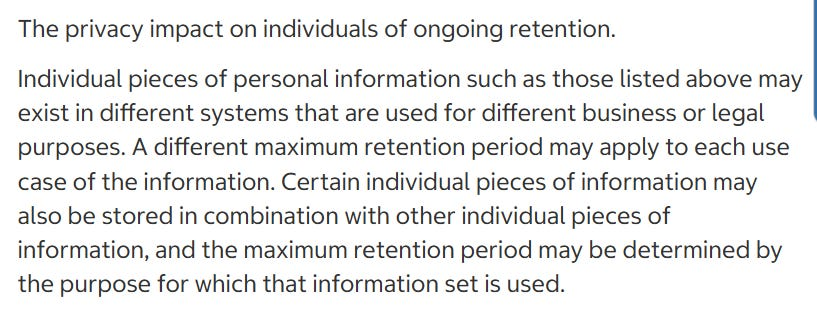

# Policy & Terms Review; Costco (Membership Only Retail Wholesaler)

Costco operate 924 warehouse locations across 14 countries worldwide, serving over 145 million cardholders globally through around 82 million member accounts.

In fiscal year ending 2025 they amassed a global net revenue of $269.8 billion.

Not bad for a members only retailer of traditionally good value merchandise at discounted prices.

This article consists of a review of Costco’s;

* [Privacy Policy](https://www.costco.com/f/-/privacy-policy)
* [Automated Licence Plate Recognition Usage and Policy](https://www.costco.com/f/-/privacy-policy#recognition)
* [Consumer Health Data Privacy Notice](https://www.costco.com/f/-/consumer-health-data-privacy-policy)
* [Terms & Conditions](https://www.costco.com/f/-/terms-and-conditions-of-use)
* [Member Privileges and Conditions](https://www.costco.com/f/-/member-privileges-conditions)
* [Cookie Policy List](https://www.costco.co.uk/cookie-policy-list)
* [Costco Third Party Disclosure Notice](https://gdx-assets.costco.com/adobe/assets/urn:aaid:aem:aa6b77a0-d911-4235-821a-d73cbcd10e0d/original/as/Third%20Party%20Disclosures%20Notice.pdf)
* [Costco Health Centres Notice of Privacy Practices](https://www.costco.com/wcsstore/CostcoUSBCCatalogAssetStore/rx/HIPAA-Privacy-Practice-19.pdf)

**WHAT INFORMATION IS COLLECTED BY COSTCO**

The information Costco collects depends on how the user interacts with their services (i.e. online only or in store only, or a mix of both), not all instances of data collection apply to all people.

Costco state they collect the following information;

* Name
* Username
* Email Address
* Physical address
* Phone number
* Membership account number
* Identity document information (drivers license or passport) and details within the document
* Date of Birth
* Photograph
* Online account credentials
* Employer name (if the user signs up for membership via their employer)
* Age
* Gender
* Veteran status or membership in organisations that offer discounted costco memberships
* Payment card information
* Delivery information
* Billing address
* Travel documentation (if using Costco Travel)
* Facial images and measurements
* Purchases and transaction information
  * Product details
  * Purchase price
  * Date of purchase
  * Tender type
  * Location of transaction
* Usage and interactions of Costco online services
  * Referring URL
  * Pages viewed
  * How long spent on a page
  * Access times
  * _“We capture images of screens you view and collect information about how you interact with particular screens”_
* Device information
  * IP Address
  * _“Other unique device identifiers”_
  * Device type
  * Device operating system
  * Operating System version
  * Browser type
  * Language
  * Software settings and configurations
  * Mobile network information
* Geolocation (when connecting to a Costco provided Wi-fi at a warehouse or use a location based feature)
* Call recordings and transcripts (if the user interacts with Costco by phone or chat)
* Video and digital images (in stores/parking lots, when using virtual try-on features or when retrieving products from lockers)
* Biometrics
* Images of licence plate (licence plate number, state and _“other vehicle information if you park on or near our facilities”_)

Costco state they may also obtain information from other sources;

* Commercial data brokers
* Other companies with which the person engages

Some information collected falls under the category of “health data”.

**DATA RETENTION**

Costco state in a very waffly way that they retain data in an ongoing fashion, providing no indication of retention periods and state in no capacity that data is ever deleted

We are operating on a trust me bro basis with this one.

Automatic License Plate Recognition data is retained for _“approximately 180 days”_ unless a reason warrants longer retention (incident investigation etc)

**WHAT IS DISCLOSED AND TO WHO**

Costco state they may disclose personal information to;

* Other account members and account administrators (_“if your employer purchased your membership, we may disclose your name, address, purchase history and membership level or status to your employer”)_
* Household or business affiliate members
* Other companies the person engages with
* Businesses offering co-branded products or services
* Affiliates
* Service providers (including vendors, corporate affiliates and related companies)
* Service providers
* Citi (where a member applies for a Citi/Costco Anywhere Visa Card)
* Suppliers
* Shipping vendors
* Advertising, marketing and analytics providers (including advertisers, publishers, social media platforms, advertising technology providers and measurement and analytics vendors)
* To meet legal or regulatory requirements

Additionally, Costco discloses to tobacco manufacturers the name, address, brand(s) purchased and amount of product purchased by business members who acquire tobacco products through Costco.

You can view the [28 A4 page long list of third parties Costco has shared personal information with during at least the last six months here](https://gdx-assets.costco.com/adobe/assets/urn:aaid:aem:aa6b77a0-d911-4235-821a-d73cbcd10e0d/original/as/Third%20Party%20Disclosures%20Notice.pdf)

**TERMS OF SERVICE**

Shirts and shoes must be worn on Costco property at all times (thats actually a clause in the terms, lol)

**COOKIES**

The list of cookies that Costco deploy can be [found here](https://www.costco.co.uk/cookie-policy-list)

**OTHER CONSIDERATIONS**

If using mobile methods of payment, the facilitator of the payments receive information about the transaction(s) in order to facilitate them (i.e. using apple pay etc) - at least just using your debit/credit card and/or cash there is no additional layer of third parties having access to said personal information.
